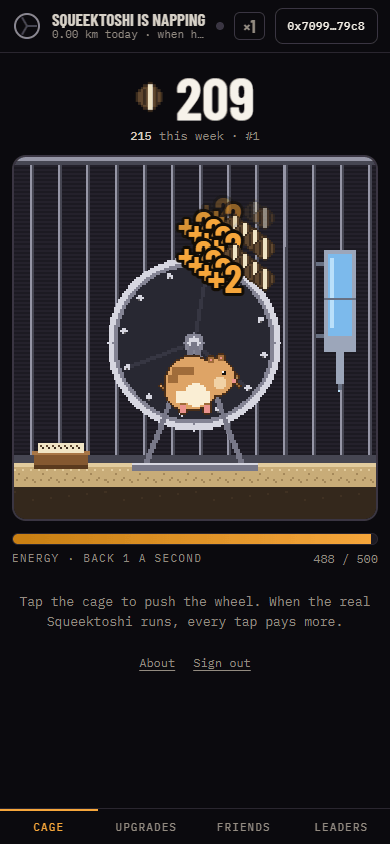

# Wheelmates

Push the wheel with Squeektoshi. A tap game around the real hamster whose wheel powers
[Squeekchain](https://squeekchain.com): seeds for taps, a multiplier when he runs, chests when Squeek blocks are
found, six cage upgrades, a bonus for Squeek holders, friends, a daily streak and weekly leaderboards. Built for the
[Squeekchain Genesis Code Lane](https://squeekchain.com/genesis/code). Testnet only: seeds have no value, there is no
token and nothing is sold. Not affiliated with Squeekchain.

## How the hamster plays

| Squeektoshi | What happens in the game |
| --- | --- |
| still or off air | taps pay ×1, passive income ×1 |
| running (two readings in a row) | your wheel turns at his real RPM, taps pay ×2 (+0.1 per Sneakers level), passive ×1.5 |
| zoomies (4.5 km/h or more) | taps pay ×3 (+Sneakers), passive ×1.5 |
| a settlement completes Squeek blocks | every player seen in the last day gets a chest: 50 + half an hour of pantry + 20 strong taps |

Energy: 500 base, one tap each, back at 1 per second (more with Bedding); the server takes at most 15 taps a second.
Upgrades: Wheel (tap power), Water bottle (energy), Bedding (regen), Pantry (seeds per hour, kept 3 to 12 hours while
away), Seed stash (those hours), Sneakers (the live multiplier). Holder bonus: 10% per Squeek-equivalent (a Level 2
is 2.2), up to 50%. Daily bonus: 100 × streak up to 7. Friends: 5% of the first ten friends' taps and chests, up to
20,000 a week. Seasons are ISO weeks (Monday 00:00 UTC). The full rules, with every number, are in
[the design](docs/superpowers/specs/2026-11-09-wheelmates-design.md).

Sign in with a wallet (a signed message: no gas, no transaction, no chain switch) or **play as a guest** with nothing to
sign. A guest's cage moves to the wallet when one is linked, unless that wallet already has a cage of its own. Guests
get no holder bonus.



## Run it

```sh
cd server && npm install && npm test && npm start      # API on http://127.0.0.1:8790, SQLite file next to it
python -m http.server 8080 -d web                       # the site; web/config.js points at the API
python tools/art.py                                     # redraw the pixel art (Pillow)
